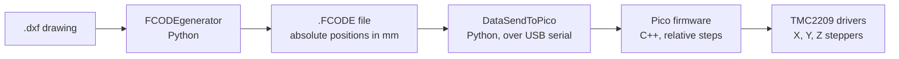
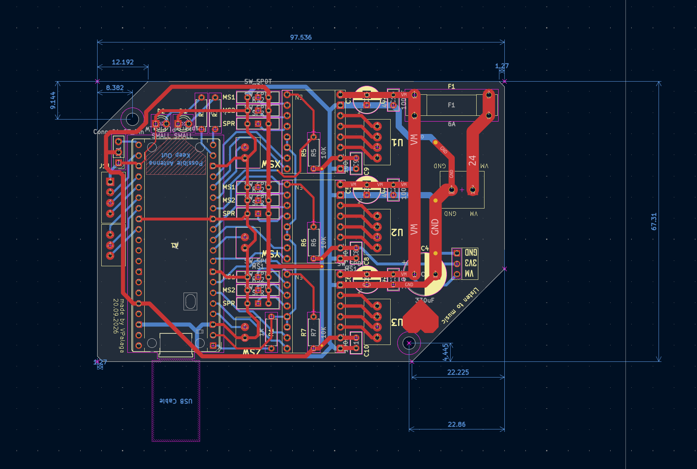

# DrawMachine

**An XY pen plotter driven by a Raspberry Pi Pico and a home-made G-code dialect called FCODE.**

Feed it a `.dxf` drawing, it works out where the pen has to go, and a Pico steps three stepper motors (X, Y and a Z pen lift) to draw it on A4 paper.

> **The goal:** a 100% working, reliable XY plotter that does my homework.
> Partially based on the Scrabble bot.

---

## How it works



1. **`FCODEgenerator`** reads a DXF (or you script the pen by hand), centres it on the paper, reorders the strokes to minimise pen travel, and writes an `.FCODE` text file. Positions are in **millimetres**.
2. **`DataSendToPico`** reads the FCODE file line by line, converts millimetres to motor steps, range-checks every move and sends one command at a time to the Pico over USB CDC (virtual serial port). It waits for the Pico to confirm each command.
3. **`StepperDriver-pico`** is the firmware. It parses each command, runs a Bresenham-style line algorithm so X and Y arrive together, lifts and lowers the pen, and homes against the end switches.

---

## Repository layout

| Path | What's in it |
| --- | --- |
| `FCODEgenerator/` | DXF reader, path optimiser, FCODE writer and preview renderer (Python) |
| `FCODEgenerator/dxfexamples/` | Sample DXF files to try |
| `DataSendToPico/` | Host-side sender: file runner, mm to steps conversion, serial transport, test CLI and GUI (Python) |
| `StepperDriver-pico/` | Pico firmware (C++ / Pico SDK) |
| `StepperDriver-pico/bresenham_test.py` | Draws the step pattern of the line algorithm with PIL, used to design the move function |
| `pcb/2.0/DrawMv2.0/` | **Current board**: KiCad project for the v2.0 controller PCB |
| `pcb/test/` | Retired first prototype board (v1), kept for reference only |
| `pcb2_0_schematic.pdf` | PDF of the v2.0 schematic |
| `images/` | Documentation images |

---

## Hardware

- **Controller:** Raspberry Pi Pico (USB CDC serial to the PC).
- **Drivers:** three **TMC2209** stepper drivers, one each for X, Y and Z. Microstepping is set on the board with switches, and the host software assumes **8x**.
- **Motion:** 200 steps/rev steppers on 2 mm pitch rods, so the host uses **800 steps per mm** (200 x 8 microsteps / 2 mm).
- **Pen lift:** the Z stepper raises and lowers the pen (6500 steps between up and down, still marked "needs to be tested" in the code).
- **Limit switches:** one each for X, Y and Z. They are used only for calibration.
- **Work area:** A4 landscape, 297 x 210 mm (A5 and A3 are also defined in the generator).
- **Indicators:** an "instruction" LED (lit while commands are arriving) and a "console mode" LED.
- **Board extras (v2.0):** 6 A fuse and bulk capacitor on the motor supply, status LEDs and a debug header.

### Pin map (from `motorDriver.cpp`)

| Function | GPIO |
| --- | --- |
| X stepper: STEP / DIR / EN | 13 / 12 / 10 |
| Y stepper: STEP / DIR / EN | 8 / 6 / 9 |
| Z stepper: STEP / DIR / EN | 4 / 3 / 5 |
| End switch X / Y / Z | 11 / 7 / 2 |
| Manual jog X+ / X- / Y+ / Y- | 22 / 21 / 20 / 19 |
| Extra buttons B1 / B2 | 18 / 17 |
| LED instruction / console mode | 15 / 14 |

All switches are wired between the GPIO and GND and use the Pico's internal pull-up, so a closed switch reads as "pressed". Motor enable pins are active low.

---

## Getting started

### 1. Build and flash the firmware

Requirements: Pico SDK 2.2.0, CMake 3.13+, the ARM GNU toolchain (the CMake file is set up for the VS Code Pico extension).

```bash
cd StepperDriver-pico
mkdir build && cd build
cmake ..
make -j
```

Hold **BOOTSEL**, plug the Pico in, and copy `motorDriver.uf2` onto the drive that appears. On boot the console LED blinks six times.

`CMakeLists.txt` defaults to `PICO_BOARD pico`. If you are using a Pico 2 / Pico 2 W, configure with `cmake -DPICO_BOARD=pico2_w ..` (or `pico2`).

### 2. Install the Python dependencies

Python **3.10+** is required (the code uses `match` and `X | Y` type hints).

```bash
pip install ezdxf numpy pillow pyserial
```

The GUI also needs `tkinter`, which ships with most Python installers.

### 3. Generate an FCODE file

Run from inside `FCODEgenerator/` (the modules import each other without a package prefix), and create the output folder first:

```bash
cd FCODEgenerator
mkdir .fcodes
```

```python
from main import FGenerator

gen = FGenerator("dxfexamples/simpleShape.dxf",
                 acc=0.1,          # curve flattening accuracy in mm
                 text=False,       # True = also draw TEXT / MTEXT as outlines
                 optimize=True,    # reorder strokes to cut pen travel
                 join_tol=0.5)     # points closer than this (mm) count as the same point

gen.generate_instructions()
gen.save(show_visualization=True)  # writes .fcodes/simpleShape.FCODE and opens a preview
```

The preview draws pen-down moves in black, pen-up travel in red and the paper outline in blue, so you can check placement before anything moves.

### 4. Plot it

Plug the Pico in **before** starting Python, then:

```bash
cd DataSendToPico
python -c "from Controller import Controller; Controller('../FCODEgenerator/.fcodes/simpleShape.FCODE').do_file()"
```

(or edit the path in `use_example.py` and run that).

Creating the controller **homes the machine straight away**: it sends `CLB`, then moves the head to the paper origin. Make sure the carriage has room to move before you run it.

---

## FCODE

### File format

An FCODE file is plain text: a header, then one instruction per line.

```
header_length 3
name simpleShape
plane_size_mm (297, 210)
MOV 10.0 10.0
PDN
MOV 10.0 200.0
MOV 287.0 200.0
MOV 287.0 10.0
MOV 10.0 10.0
PUP
MOV 76.54 127.03
PDN
MOV 88.93 142.52
...
```

- `header_length` is the number of header lines (including itself). The sender skips that many lines.
- `MOV x y` in a file is an **absolute position in mm**, measured from the bottom-left corner of the paper. Coordinates are rounded to 0.01 mm.
- The pen starts up, so the first stroke begins with a travel `MOV` followed by `PDN`.

### Instructions

| Instruction | Args | Meaning | Where it runs |
| --- | --- | --- | --- |
| `MOV x y` | 2 | Move the head to (x, y) in mm. Draws if the pen is down | Host converts to relative steps, Pico executes |
| `PUP` | 0 | Pen up | Pico |
| `PDN` | 0 | Pen down | Pico |
| `WAT s` | 1 | Wait *s* seconds | Pico |
| `CLB` | 0 | Calibrate X and Y against the end switches, then calibrate Z. The host then moves to the paper-origin offset and zeroes its position | Host and Pico |
| `HCB` | 0 | Calibrate Z (pen head) only | Pico |
| `HOM` | 0 | `HCB`, then move to the home position `(0, 200)` mm | **Host only** |
| `SCM m` | 1 | Set console mode (0, 1 or 2) | Pico (used internally by the sender) |

`PUP` and `PDN` return an error from the Pico if the pen is already in that state. The generator never emits redundant ones.

### Automatic recalibration

To fight lost steps on long jobs, the generator inserts `HCB` every 500 instructions and `CLB` every 2000 (`head_calibration_after_instruction` and `overall_calibration_after_instruction`).

### Writing FCODE by hand

`FGenerator` also works without a DXF. Pass a name instead of a `.dxf` path and drive the pen yourself:

```python
from main import FGenerator
from gen import PAPER_SIZES

w, h = PAPER_SIZES["A4"]
gen = FGenerator("outline_A4", text=False, optimize=True, join_tol=0.5)

gen.draw_to(0, h)
gen.draw_to(w, h)
gen.draw_to(w, 0)
gen.draw_to(0, 0)
gen.home()
gen.save()
```

Available calls: `pen_up`, `pen_down`, `move_to`, `travel_to` (pen up, then move), `draw_to` (pen down, then move), `draw_polyline`, `wait`, `head_calibrate`, `calibrate`, `home`, `save`. See `example_manual_instructions.py` for a 5000-segment random-walk example.

### Supported DXF content

`LINE`, `CIRCLE`, `ARC`, `ELLIPSE`, `LWPOLYLINE`, `POLYLINE`, `SPLINE`, `SOLID` / `TRACE` / `3DFACE`, `POINT` (drawn as a small circle), `TEXT` / `MTEXT` / `ATTRIB` (as outlines, only with `text=True`). Block references (`INSERT`) and `DIMENSION` entities are exploded. Anything else is skipped.

---

## Pico serial protocol

The Pico enumerates as a USB CDC serial device. The sender finds it by USB vendor ID `2E8A`.

- The host sends **one line per instruction**, terminated with `\n`, at most 127 characters.
- Arguments are separated by whitespace. On the wire `MOV` takes **relative steps**, not millimetres (`MOV 800 -1600` moves +1 mm in X and -2 mm in Y).
- For every line the Pico replies with **two lines**:
  1. **Receive status**, sent immediately: `0` = line understood, `1` = rejected (unknown instruction, wrong argument count, or a bad number). After a `1` there is no second reply.
  2. **Finish status**, sent when the instruction is done: `0` = OK, `1` = failed (for example a limit switch was never reached during calibration).
- If no instruction arrives for **3 seconds**, the instruction LED goes off and the motor drivers are disabled.

### Firmware behaviour

- **Line algorithm:** the axis with more steps is the "lead". For each lead step, the follow axis steps whenever its rounded ideal position has advanced. This keeps the head close to the true straight line (see the picture below).
- **Timing:** each step is a pulse with a 75 us half-cycle on X/Y (about 150 us per step, so roughly 8 mm/s on the leading axis at 800 steps/mm) and 100 us on Z. Tunable in the `Settings` struct in `motorDriver.cpp`.
- **Motors are released between moves** to keep them cool. This also means the pen holder can sag slightly between moves.
- **Calibration** drives X and Y towards their switches, then raises Z until its switch triggers. Every calibration loop has a step limit (400000 for XY, 50000 for Z) so a missing or miswired switch can't make it run forever. The pen is then known to be up.


---

## Host-side tools (`DataSendToPico/`)

| File | Purpose |
| --- | --- |
| `Controller.py` | Reads an FCODE file and runs it instruction by instruction, printing progress |
| `MotorController.py` | mm to steps conversion, range checks (297 x 210 mm), paper-origin offset (A4 preset: 33 mm, 48 mm from the switches, so measure your own), request logging |
| `MotorOverclass.py` | Per-axis constants and position bookkeeping (steps per mm, max travel) |
| `CDC_send.py` | `Transmitter`: finds the Pico, sends commands and reads the two status replies, with a 200 s response timeout |
| `CDC_test.py` | Tiny CLI: type raw instructions such as `MOV 100 100` and see both replies |
| `CDC_gui.py` | Tkinter GUI for the same thing, with quick buttons for `CLB`, `HCB`, `PUP`, `PDN` |
| `settings.py` | `SPEED_MODE` (skips response validation) and other flags |
| `tools.py` | Coloured request timing/logging helpers |

---

## PCB

The controller board is **v2.0**, designed in KiCad (about 98 x 67 mm). It carries the Pico, three TMC2209 drivers (U1 to U3, one per axis), per-driver microstepping switches, end-switch inputs, a fused motor supply (6 A fuse and a 330 uF bulk capacitor), status LEDs and a debug header. This is the board the firmware pin map targets.



- KiCad project: `pcb/2.0/DrawMv2.0/`
- Schematic PDF: `pcb2_0_schematic.pdf`

The v1 prototype in `pcb/test/` is no longer used and is kept only for reference. The `*-backups` folders are KiCad's automatic backups.

---

## Known issues and to-do

- [ ] `MotorController.wait()` builds its command with `"WAT " + secs`, which raises a `TypeError` because `secs` is a float. Use `str(secs)`.
- [ ] `FCODE.save()` does not create the output folder. `.fcodes/` must exist or saving fails.
- [ ] `Transmitter` in `CDC_send.py` looks for the Pico when the module is imported, so the Pico has to be plugged in before you import it.
- [ ] `Pico_pins_map.txt` is out of date and does not match the pins in `motorDriver.cpp`. Use the table above.
- [ ] `StepperDriver.cpp` assumes 1000 steps per revolution when printing head position, while the host assumes 1600 (8 x 200). Positions printed by the firmware will not match.
- [ ] Manual jog buttons are implemented (`manual_instruction()`) but the call in the main loop is commented out.
- [ ] `use_example.py` contains a hard-coded Windows path, and `example_from_dxf.py.py` has a double extension and a Windows-style path separator.
- [ ] No `requirements.txt` yet.
- [ ] Standard G-code support, which would be easier than maintaining FCODE.